# Developer Technology Trends — IBM Data Analyst Capstone

**Eduard Kogan** · IBM Data Analyst Professional Certificate (Coursera) · November 2026 · Final grade **100%**

📊 **[Live dashboard (Looker Studio)](https://datastudio.google.com/reporting/08c01067-2253-41c3-9d22-89f28c48fdf4)** · 📄 **[Final report (PDF)](06-report/Data%20Analyst%20Capstone%20Project%20Report.pdf)**

---

## The question

Which programming languages, databases and platforms do developers use today, which ones do they want to use next year, and what drives developer pay and job satisfaction?

The audience is hiring managers, tech leaders planning a stack, and developers deciding what to learn next.

## Data

| Source | How it was collected | Size |
|---|---|---|
| Stack Overflow Developer Survey 2024 | CSV loaded with pandas | 65,457 rows × 114 columns |
| Job postings API | Python `requests` + JSON → `job-postings.xlsx` | Postings by location and technology |
| Programming language salary table | Web scraping with BeautifulSoup → `popular-languages.csv` | 10 languages |

The raw survey file is not stored in this repo. The notebooks download it from IBM's course storage.

## Approach

| Step | What I did | Folder |
|---|---|---|
| 1. Collect | Called a REST API, scraped an HTML table, explored the survey's shape and data types | [`01-data-collection`](01-data-collection) |
| 2. Wrangle | Removed duplicates (65,457 → 65,437), found and imputed missing values, normalized salary (Min-Max, Z-score, log), one-hot encoded categories | [`02-data-wrangling`](02-data-wrangling) |
| 3. Explore | Distributions, IQR outlier removal (978 salaries above $220,861), correlations, salary by country | [`03-eda`](03-eda) |
| 4. Visualize | Histograms, box, scatter, bubble, pie, stacked, line and bar charts; split multi-select answers with `str.split(';').explode()` | [`04-data-visualization`](04-data-visualization) |
| 5. Dashboard | Pre-aggregated 12 tidy CSVs in pandas → 3-page Google Looker Studio dashboard | [`05-dashboard`](05-dashboard) |
| 6. Report | 22-slide findings report | [`06-report`](06-report) |

**Tools:** Python (pandas, NumPy, matplotlib, seaborn, requests, BeautifulSoup), SQL (SQLite), Jupyter, Google Looker Studio, PowerPoint.

## Key findings

### Programming languages: JavaScript leads today, Python leads tomorrow

| Current year (have worked with) | Next year (want to work with) |
|---|---|
| 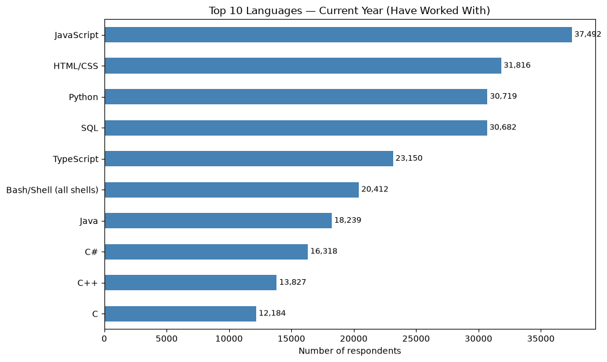 | 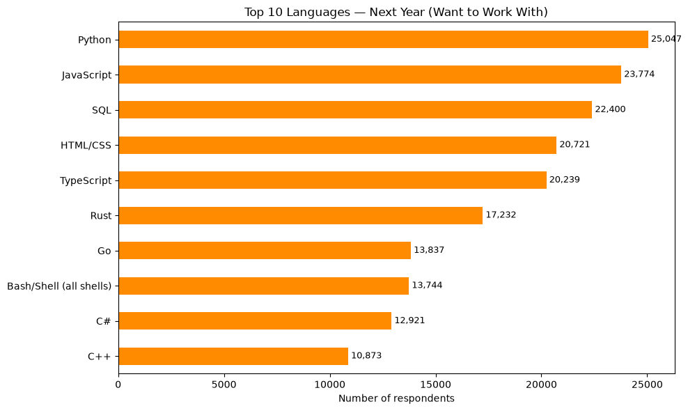 |

- JavaScript is the most used language (37,492), but **Python is the most wanted** for next year (25,047).
- **Rust and Go** are not in today's top 10, but both enter the wanted top 10. **Java and C drop out.**
- SQL stays in the top 4 in both years. It is a core skill for every role.

### Databases: PostgreSQL is #1 now and next year

| Current year | Next year |
|---|---|
| 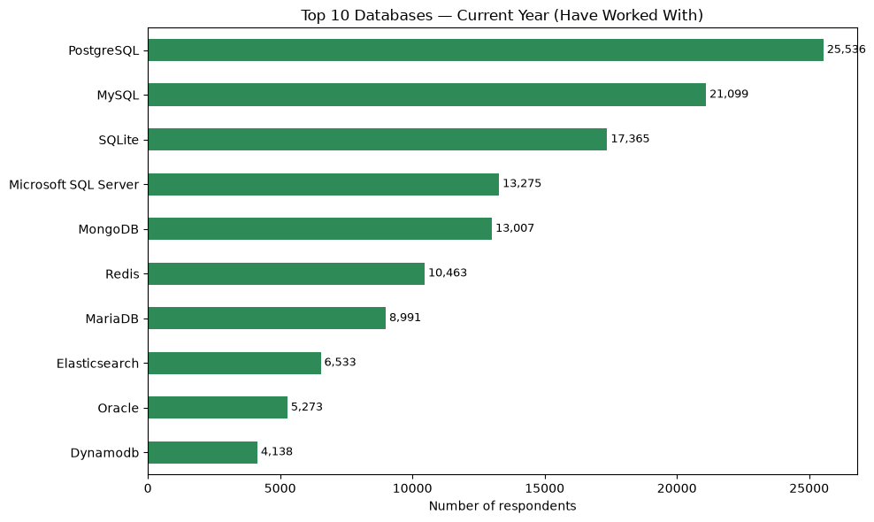 | 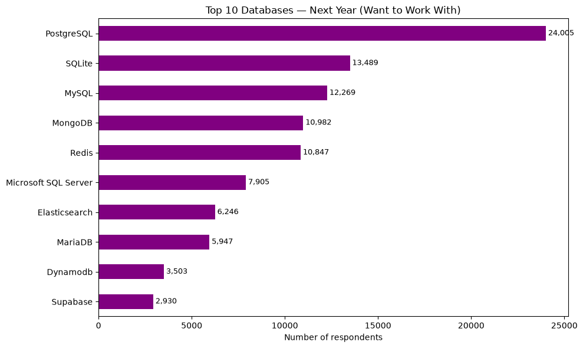 |

- **PostgreSQL** leads in both years (25,536 → 24,005).
- SQLite rises to #2. MS SQL Server interest drops from 13,275 to 7,905. Oracle drops out and Supabase (cloud PostgreSQL) enters the top 10.

### Job market and pay

| Job postings by location | Average salary by language |
|---|---|
| 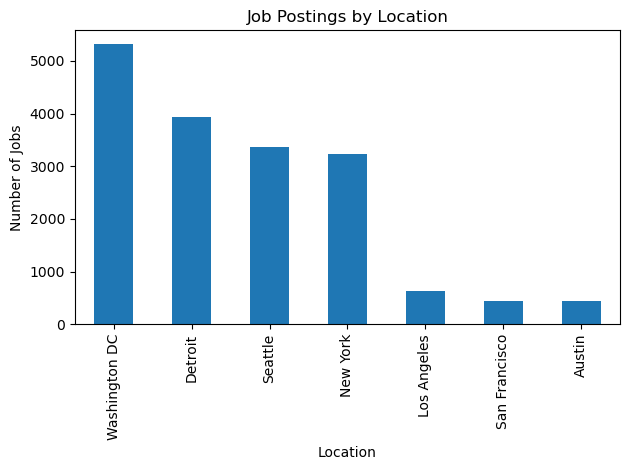 | 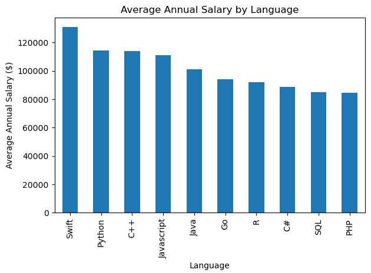 |

| Median pay by experience | Pay by country (outliers removed) |
|---|---|
| 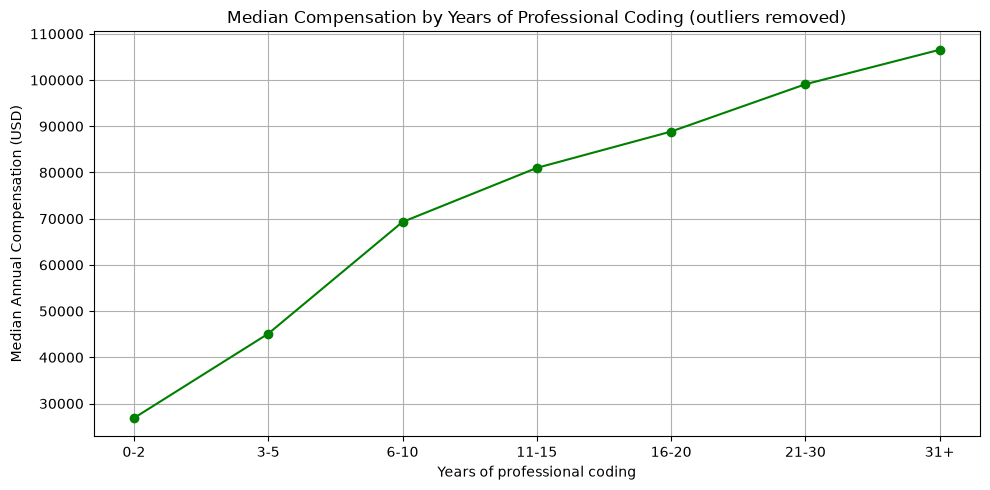 | 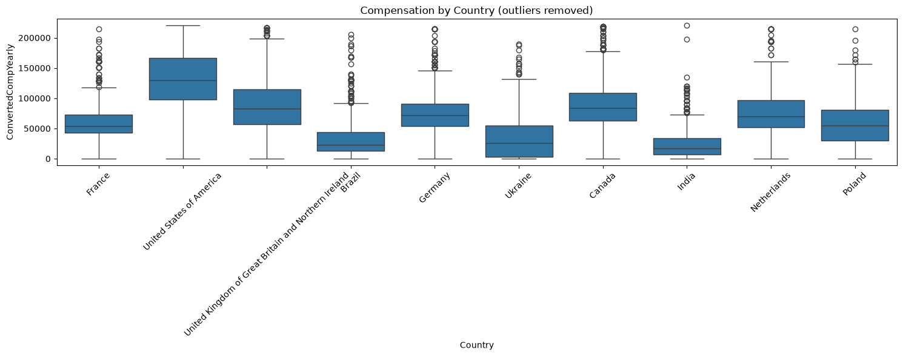 |

- Washington DC has the most job postings (5,316). Swift has the highest average salary ($130,801) and PHP the lowest ($84,727).
- Median pay rises steadily with experience: about **$27K at 0–2 years → $106K at 31+ years**.
- **Country matters most:** the US median is about $130K and India's about $17K.
- Job satisfaction is barely related to pay (r = 0.08).

## Dashboard

Built in Google Looker Studio from a lab sample of the survey (18,845 respondents). **[Open the live dashboard →](https://datastudio.google.com/reporting/08c01067-2253-41c3-9d22-89f28c48fdf4)**

| Current Technology Usage | Future Technology Trends | Demographics |
|---|---|---|
| 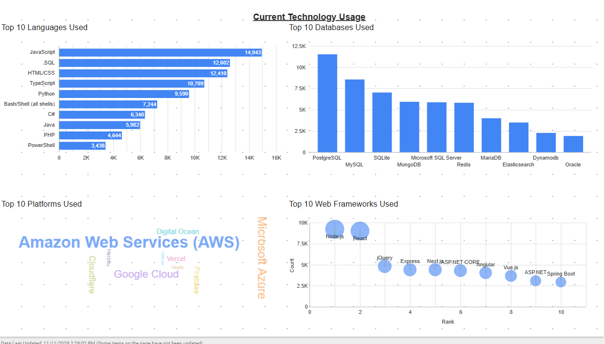 | 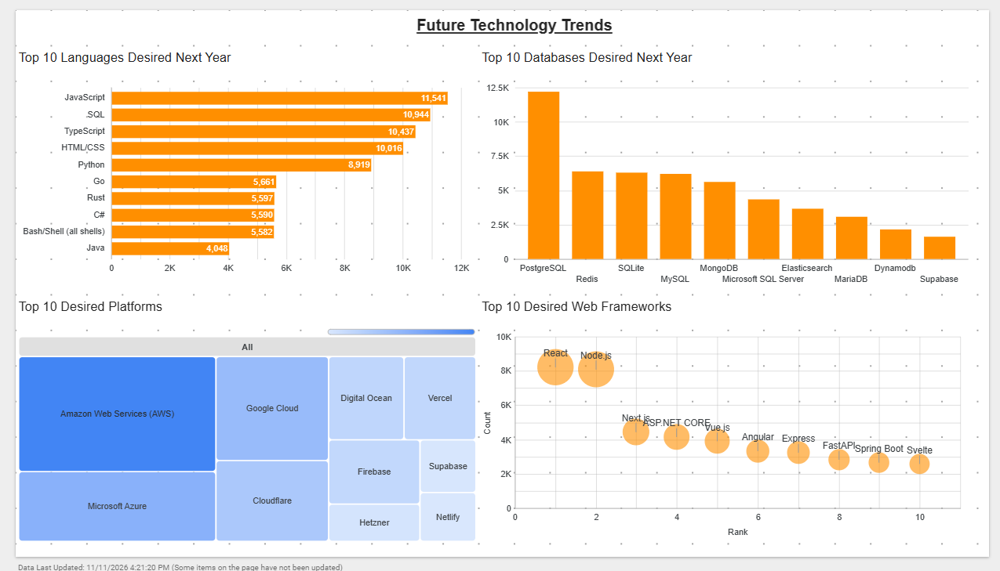 | 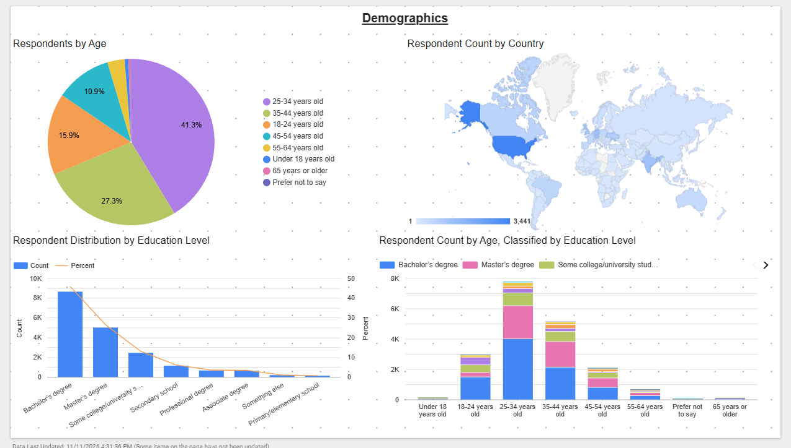 |

Respondents are mostly aged 25–44 (68.6%). 72% hold a Bachelor's or Master's degree, and the US is the largest group.

## What this means

- **For hiring and learning:** Python, SQL and PostgreSQL are safe, high-demand skills.
- **For tech leaders:** plan for Rust, Go, TypeScript and cloud databases, and budget for moving off legacy commercial systems.
- **For retention:** salary alone does not keep developers satisfied.

## Limitations

- The survey is self-reported and leans toward the US and Europe.
- Multi-select answers show popularity, not market share.
- Salary is missing for 64% of respondents. Pay analysis uses real reported values only, with outliers removed.
- Job-posting counts per technology came from keyword matching, which inflates short names such as "C".

## Repository structure

```
01-data-collection/      API, web scraping and first look at the survey (labs 2–5)
02-data-wrangling/       duplicates, missing values, normalization (labs 6–11)
03-eda/                  distributions, outliers, correlation (labs 12–15)
04-data-visualization/   chart types and the rubric charts (labs 16–24)
05-dashboard/            prepare_dashboard_data.py + 12 tidy CSVs for Looker Studio
06-report/               final report (PDF)
images/                  charts used in this README
```

## Run it yourself

```bash
pip install pandas numpy matplotlib seaborn requests beautifulsoup4 openpyxl jupyter
jupyter notebook
```

---

*Completed as part of the [IBM Data Analyst Professional Certificate](https://coursera.org/verify/professional-cert/MYRLINWX4I0X) on Coursera. The lab structure and datasets come from IBM Skills Network. The analysis, code comments, dashboard and report are my own.*
